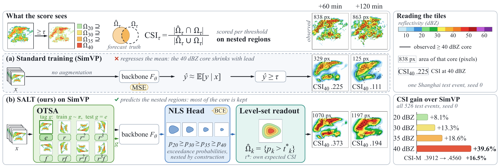
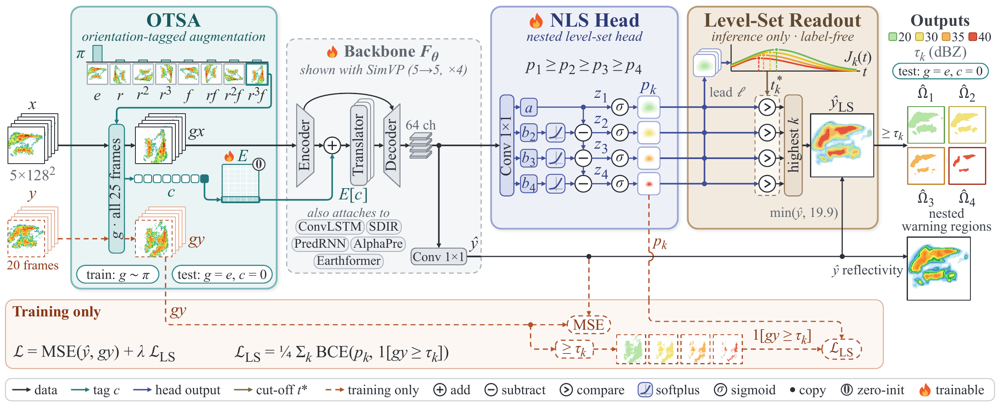
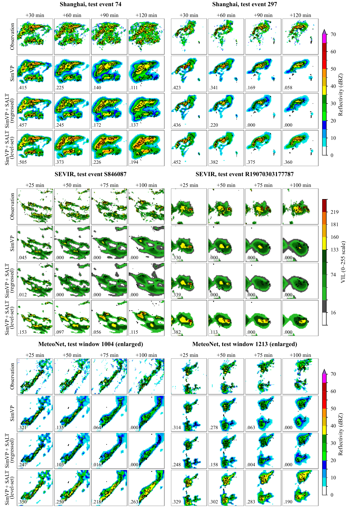
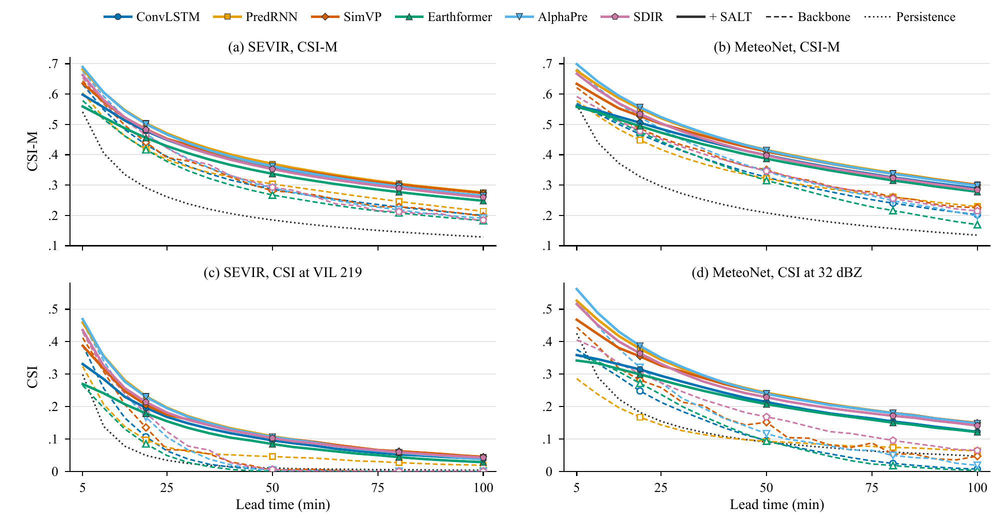
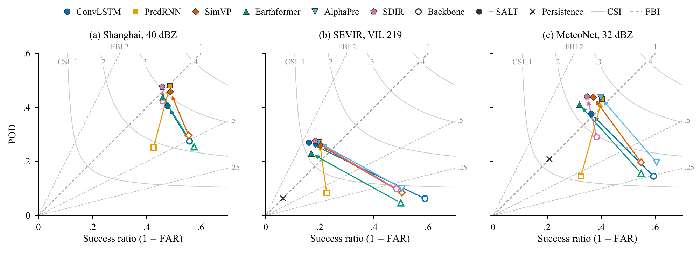

# SALT: Symmetry-Augmented Level-Set Training for Radar Echo Extrapolation

**Learning Not to Average: Symmetry-Augmented Level-Set Training for Radar Echo Extrapolation**

Feilong Bi1, Suting Chen1,✉, Bingcheng Wan2

1School of Electronics and Information Engineering, 2School of Artificial Intelligence, 
Nanjing University of Information Science and Technology

Paper: coming soon &nbsp;·&nbsp; Code: released upon acceptance

> [!NOTE]
> The code, configurations and trained checkpoints will be released in this repository after the paper is accepted. Star or watch the repository to be notified.

  

## Overview

Radar echo extrapolation is verified as warning regions, the places where reflectivity will exceed operational thresholds, yet deep extrapolators are trained to regress the reflectivity field pointwise. Pointwise regression averages over the possible outcomes at each pixel: the regressed value shrinks intense echoes and cannot tell the model how much to warn.

**SALT** is a backbone-agnostic training framework that learns not to average:

- **NLS Head (nested level-set head)** predicts exceedance probabilities at all thresholds, nested by construction.
- **Level-Set Readout** reads the warning regions from these probabilities by maximizing the model's own expected critical success index, without labels or tuned parameters.
- **OTSA (orientation-tagged symmetry augmentation)** enlarges small regional archives with rotations and flips and tags each sample with its transform, so that the forecast is not averaged over orientations.

At negligible inference cost, SALT raises the mean CSI of every backbone it is attached to: by 6–24% on Shanghai, 16–21% on SEVIR and 16–26% on MeteoNet, with the largest gains at the highest thresholds.

  

## Main results

CSI-M (mean CSI over the warning thresholds) of each backbone before → after SALT, with the relative gain:

| Backbone | Shanghai | SEVIR | MeteoNet |
|:--|:-:|:-:|:-:|
| ConvLSTM | .3843 → **.4299** (+11.9%) | .3215 → **.3750** (+16.7%) | .3422 → **.4051** (+18.4%) |
| PredRNN | .3775 → **.4692** (+24.3%) | .3275 → **.3971** (+21.3%) | .3442 → **.4352** (+26.4%) |
| SimVP | .3912 → **.4560** (+16.5%) | .3260 → **.3863** (+18.5%) | .3646 → **.4239** (+16.3%) |
| Earthformer | .3819 → **.4363** (+14.2%) | .3007 → **.3563** (+18.5%) | .3305 → **.3949** (+19.5%) |
| AlphaPre | – | .3311 → **.3907** (+18.0%) | .3717 → **.4364** (+17.4%) |
| SDIR | .4278 → **.4532** (+5.9%) | .3268 → **.3795** (+16.1%) | .3582 → **.4180** (+16.7%) |

On CIKM 2017 (SimVP only), SALT raises CSI-M from .3632 to .4098.

All models predict 20 frames from 5 at 128 × 128 (Shanghai: 6-min frames, 120 min ahead; SEVIR and MeteoNet: 5-min frames, 100 min ahead). Backbone rows use the raw regressed output; + SALT rows use the label-free level-set readout. Each backbone and its SALT version are trained under the same protocol, and every SALT gain has a 95% paired block-bootstrap interval that excludes zero.

<b>Shanghai</b> (thresholds in dBZ)

| Method | Venue | CSI-20 ↑ | CSI-30 ↑ | CSI-35 ↑ | CSI-40 ↑ | CSI-M ↑ | Gain | HSS ↑ | FBI@40 (→1) |
|:--|:--|--:|--:|--:|--:|--:|--:|--:|--:|
| ConvLSTM | NeurIPS 2015 | .5310 | .4369 | .3481 | .2213 | .3843 | – | .5191 | .49 |
| &emsp;+ D4 | – | **.5635** | .4725 | .3855 | .2594 | .4202 | +9.3% | .5589 | .60 |
| &emsp;+ SALT (ours) | – | .5618 | **.4821** | **.3941** | **.2816** | **.4299** | +11.9% | **.5721** | .85 |
| PredRNN | NeurIPS 2017 | .5501 | .4329 | .3315 | .1955 | .3775 | – | .5133 | .59 |
| &emsp;+ D4 | – | .5708 | .4631 | .3664 | .2382 | .4096 | +8.5% | .5471 | .66 |
| &emsp;+ SALT (ours) | – | **.5960** | **.5151** | **.4354** | **.3302** | **.4692** | +24.3% | **.6100** | .99 |
| SimVP | CVPR 2022 | .5407 | .4429 | .3532 | .2282 | .3912 | – | .5254 | .53 |
| &emsp;+ D4 | – | .5582 | .4603 | .3687 | .2428 | .4075 | +4.2% | .5450 | .57 |
| &emsp;+ SALT (ours) | – | **.5846** | **.5018** | **.4189** | **.3186** | **.4560** | +16.5% | **.5988** | .94 |
| Earthformer | NeurIPS 2022 | .5320 | .4396 | .3457 | .2104 | .3819 | – | .5174 | .44 |
| &emsp;+ D4 | – | .5469 | .4463 | .3515 | .2171 | .3905 | +2.2% | .5255 | .46 |
| &emsp;+ SALT (ours) | – | **.5657** | **.4880** | **.4018** | **.2897** | **.4363** | +14.2% | **.5785** | .95 |
| SDIR | ICML 2026 | .5642 | .4733 | .3905 | .2833 | .4278 | – | .5675 | .92 |
| &emsp;+ SALT (ours) | – | **.5754** | **.4990** | **.4204** | **.3182** | **.4532** | +5.9% | **.5941** | 1.04 |

+ D4: untagged rotation/flip augmentation, raw output. Bold: best within each backbone. FBI: frequency bias at the highest threshold (1 = unbiased).

<b>SEVIR</b> (thresholds in VIL, 0–255 scale)

| Method | Venue | CSI-16 ↑ | CSI-74 ↑ | CSI-133 ↑ | CSI-160 ↑ | CSI-181 ↑ | CSI-219 ↑ | CSI-M ↑ | Gain | HSS ↑ | FBI@219 (→1) |
|:--|:--|--:|--:|--:|--:|--:|--:|--:|--:|--:|--:|
| Persistence | – | .5358 | .4002 | .1705 | .0971 | .0713 | .0367 | .2186 | – | .2854 | .99 |
| ConvLSTM | NeurIPS 2015 | .6880 | .5792 | .2876 | .1798 | .1402 | .0539 | .3215 | – | .4111 | .11 |
| &emsp;+ SALT (ours) | – | **.7048** | **.6067** | **.3475** | **.2542** | **.2177** | **.1195** | **.3750** | +16.7% | **.4874** | 1.69 |
| PredRNN | NeurIPS 2017 | .6560 | .5832 | .2927 | .1980 | .1652 | .0697 | .3275 | – | .4243 | .38 |
| &emsp;+ SALT (ours) | – | **.7187** | **.6277** | **.3698** | **.2783** | **.2449** | **.1432** | **.3971** | +21.3% | **.5116** | 1.38 |
| SimVP | CVPR 2022 | .6885 | .5998 | .2939 | .1750 | .1331 | .0657 | .3260 | – | .4134 | .17 |
| &emsp;+ SALT (ours) | – | **.7120** | **.6193** | **.3581** | **.2649** | **.2304** | **.1331** | **.3863** | +18.5% | **.5005** | 1.29 |
| Earthformer | NeurIPS 2022 | .6885 | .5743 | .2532 | .1444 | .1049 | .0388 | .3007 | – | .3809 | .09 |
| &emsp;+ SALT (ours) | – | **.6947** | **.6001** | **.3274** | **.2225** | **.1892** | **.1036** | **.3563** | +18.5% | **.4633** | 1.37 |
| AlphaPre | CVPR 2025 | .6818 | .6123 | .2915 | .1839 | .1444 | .0724 | .3311 | – | .4162 | .20 |
| &emsp;+ SALT (ours) | – | **.7150** | **.6218** | **.3626** | **.2692** | **.2343** | **.1415** | **.3907** | +18.0% | **.5031** | 1.39 |
| SDIR | ICML 2026 | .6846 | .6031 | .2967 | .1671 | .1355 | .0739 | .3268 | – | .4137 | .20 |
| &emsp;+ SALT (ours) | – | **.7042** | **.6098** | **.3476** | **.2565** | **.2237** | **.1351** | **.3795** | +16.1% | **.4914** | 1.51 |

<b>MeteoNet</b> (thresholds in dBZ)

| Method | Venue | CSI-12 ↑ | CSI-18 ↑ | CSI-24 ↑ | CSI-32 ↑ | CSI-M ↑ | Gain | HSS ↑ | FBI@32 (→1) |
|:--|:--|--:|--:|--:|--:|--:|--:|--:|--:|
| Persistence | – | .3311 | .2832 | .2245 | .1229 | .2404 | – | .3494 | 1.00 |
| ConvLSTM | NeurIPS 2015 | .5010 | .4256 | .3171 | .1248 | .3422 | – | .4697 | .24 |
| &emsp;+ SALT (ours) | – | **.5208** | **.4773** | **.3994** | **.2229** | **.4051** | +18.4% | **.5480** | 1.03 |
| PredRNN | NeurIPS 2017 | .5071 | .4340 | .3197 | .1160 | .3442 | – | .4720 | .45 |
| &emsp;+ SALT (ours) | – | **.5425** | **.4984** | **.4308** | **.2690** | **.4352** | +26.4% | **.5782** | 1.07 |
| SimVP | CVPR 2022 | .5129 | .4414 | .3422 | .1620 | .3646 | – | .4975 | .36 |
| &emsp;+ SALT (ours) | – | **.5315** | **.4867** | **.4191** | **.2584** | **.4239** | +16.3% | **.5679** | 1.18 |
| Earthformer | NeurIPS 2022 | .4892 | .4049 | .3018 | .1262 | .3305 | – | .4554 | .28 |
| &emsp;+ SALT (ours) | – | **.5111** | **.4654** | **.3876** | **.2154** | **.3949** | +19.5% | **.5366** | 1.28 |
| AlphaPre | CVPR 2025 | .5221 | .4475 | .3492 | .1680 | .3717 | – | .5008 | .33 |
| &emsp;+ SALT (ours) | – | **.5421** | **.4989** | **.4321** | **.2727** | **.4364** | +17.4% | **.5786** | 1.09 |
| SDIR | ICML 2026 | .4600 | .4295 | .3562 | .1870 | .3582 | – | .4954 | .76 |
| &emsp;+ SALT (ours) | – | **.5239** | **.4789** | **.4124** | **.2567** | **.4180** | +16.7% | **.5599** | 1.26 |

<b>Computational cost</b>

| Model | Parameters | Added | GFLOPs | Latency (s) |
|:--|:--|--:|--:|--:|
| ConvLSTM | 12,516,265 | – | 244.80 | 0.0145 |
| ConvLSTM + SALT | 12,516,365 | 100 | 244.82 | 0.0151 |
| PredRNN | 13,914,112 | – | 297.36 | 0.0960 |
| PredRNN + SALT | 13,918,400 | 4,288 | 297.53 | 0.0951 |
| SimVP | 11,063,105 | – | 408.71 | 0.0515 |
| SimVP + SALT | 11,065,925 | 2,820 | 408.88 | 0.0528 |
| Earthformer | 1,506,877 | – | 70.78 | 0.0118 |
| Earthformer + SALT | 1,507,409 | 532 | 70.79 | 0.0120 |
| SDIR | 34,700,676 | – | 96325.85 | 0.8740 |
| SDIR + SALT | 35,319,188 | 618,512 | 96329.03 | 0.8823† |
| AlphaPre§ | 89,026,438 | – | 3110.75 | 0.0802 |
| AlphaPre + SALT§ | 89,029,444 | 3,006 | 3111.00 | 0.0813 |

GFLOPs of one 5 → 20 forecast at batch size 1; latency: median GPU time at batch size 1. SDIR + SALT is counted with the head evaluated once, at the pass where it is read; † timed with the head evaluated at every pass. § SEVIR models (AlphaPre was not trained on Shanghai).

## Visualization

Two strong-echo test cases on each benchmark. Rows: observation; SimVP; SimVP + SALT, regressed channel; SimVP + SALT, level-set readout. Black contour: observed region at 40 dBZ (Shanghai), VIL 181 (SEVIR) and 32 dBZ (MeteoNet); numbers: CSI at the same level.

  

**CSI against lead time** on SEVIR and MeteoNet (dashed: backbones; solid: + SALT; dotted: persistence):

  

**Performance diagrams** at the highest threshold (open markers: backbones; filled: + SALT):

  

## Citation

A BibTeX entry will be added once the paper is published.

## Acknowledgments

We thank the authors of DiffCast, AlphaPre and SDIR for releasing their code and data, and the providers of the Shanghai, SEVIR, MeteoNet (Météo-France) and CIKM AnalytiCup 2017 datasets.
